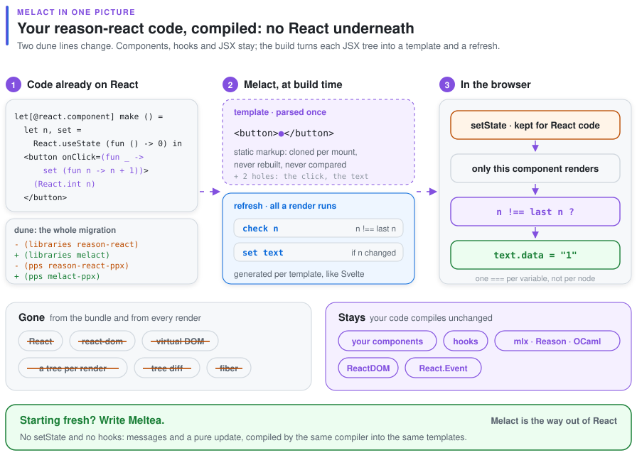
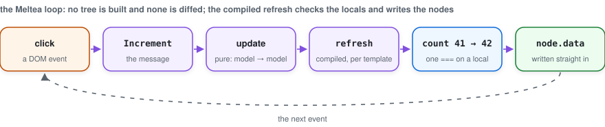
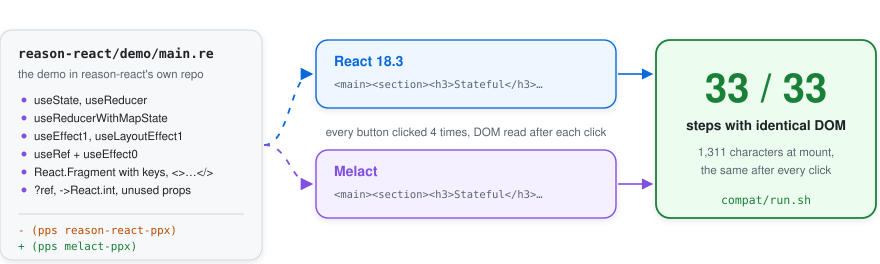

<div align="center">

<picture>
  <source media="(prefers-color-scheme: dark)" srcset="assets/logo-dark.svg">
  
</picture>

# melact

**reason-react for Melange, without React and without a virtual DOM.**

JSX compiles to DOM templates with holes. A re-render writes only the holes whose values changed.


[The idea](#the-idea) · [How it works](#how-it-works) · [Status](#status) ·
[Try it](#try-it) · [Roadmap](#roadmap) · [Not goals](#not-goals)

</div>

<br>

<picture>
  <source media="(prefers-color-scheme: dark)" srcset="assets/overview-dark.svg">
  
</picture>

> [!NOTE]
> **Milestones 1–3 of 7 are done:** the `View` layer, components with hooks, and `melact-ppx`.
> A reason-react component in mlx, Reason or OCaml compiles and runs, and one test suite passes
> both against reason-react with React 18 and against melact. The rest of the reason-react surface
> (`ReactDOM.createPortal`, the full `ReactEvent`, TodoMVC unmodified) is milestone 4.

## The idea

> Melact has a sibling, **Meltea**: the Elm architecture in OCaml, pure functions everywhere,
> views in mlx. Both share one Svelte-like compiler and a runtime that tends to zero. See
> [Meltea](#meltea) below and [`docs/vision.md`](docs/vision.md).

Take a reason-react + Melange app, change two lines in its `dune` files:

```diff
- (libraries reason-react)
+ (libraries melact)
- (preprocess (pps reason-react-ppx))
+ (preprocess (pps melact-ppx))
```

and get a build with no React in the bundle and no virtual DOM. Your components stay as they are:

```ocaml
(* counter.mlx *)
let[@react.component] make ~initial () =
  let count, setCount = React.useState (fun () -> initial) in
  let dec _ = setCount (fun n -> n - 1) in
  let tone = if count < 0 then "warm" else "calm" in
  <div className="counter">
    <button onClick=dec>(React.string "-")</button>
    <output className=tone>(React.int count)</output>
  </div>
```

melact keeps reason-react's surface (`React.useState`, `useEffect`, `useContext`, `ReactDOM.Client`,
`ReactEvent`, `ReactDOMStyle` …) and replaces what is underneath it.

## Why melact

<table>
<tr>
<td width="50%" valign="top">

**No virtual DOM.** A render does not build a tree of elements to diff. It builds one array: the
values of the holes in a template. Everything static is parsed once, at module load, and cloned.

</td>
<td width="50%" valign="top">

**The Elm model, made exact.** "Did this hole change" is `===`. An unchanged reference is an
unchanged value, so a physically equal child list or `lazy` argument skips its whole subtree.

</td>
</tr>
<tr>
<td valign="top">

**Updates start where state changed.** A `setState` re-renders its own component, not the
root. Children with physically unchanged props are skipped without `memo`.

</td>
<td valign="top">

**Few DOM moves for lists.** Keyed lists keep their common prefix and suffix, and the longest
increasing run of old positions. Swapping two of 1,000 rows is 2 `insertBefore` calls.

</td>
</tr>
<tr>
<td valign="top">

**One listener per event type.** Bubbling events are delegated to `document`. A handler is a
property on its element, so a new closure each render costs one property write.

</td>
<td valign="top">

**Still reason-react.** Same JSX in mlx, Reason or OCaml `[@JSX]`, and the same hooks with the
same signatures. Pure-OCaml reason-react code is the compatibility target.

</td>
</tr>
</table>

## How it works

<picture>
  <source media="(prefers-color-scheme: dark)" srcset="assets/vdom-dark.svg">
  
</picture>

*No virtual DOM: the DOM writes are the same, what disappears is the copy of the tree that React rebuilds and walks on every render.*

### JSX becomes a template and a hole array

<picture>
  <source media="(prefers-color-scheme: dark)" srcset="assets/pipeline-dark.svg">
  
</picture>

- **Template.** The largest static subtree of every JSX site (lowercase tags, literal attributes,
  literal text) becomes one HTML string, parsed once into a `<template>` and cloned with
  `cloneNode(true)` per mount.
- **Holes.** Each dynamic attribute, handler, text or child is a hole with a path into the clone:
  child indices for an element, a parent path and the index it goes before for inserted content.
  All paths are resolved before anything is inserted, so they never shift.
- **Refresh.** For every template the compiler also emits a refresh function, as Svelte and
  dartea do. It checks each local the view reads with one `===`, and evaluates and writes only
  the holes that read a changed one. Holes that read nothing that changed are not even computed,
  so a nested tree or a `List.map` over rows behind an unchanged local costs nothing.

### A patch is one `===` per hole

<picture>
  <source media="(prefers-color-scheme: dark)" srcset="assets/patch-dark.svg">
  
</picture>

| hole | when it differs |
|---|---|
| `HText s` | `text.data = s` |
| `HAttr (Some v)` / `HAttr None` | `setAttribute` / `removeAttribute` |
| `HProp v` | `el[name] = v` (`value`, `checked`, `innerHTML`) |
| `HStyle`, `HClass` | the old properties or classes are cleared and the new ones set |
| `HHandler f` | never compared: the stored closure is replaced |
| `HRef f` | the new callback is called with the element |
| `HChild c` | patched recursively; skipped if `c` is the same reference |

Other kinds of content, with what each patch does:

- **Text against text:** the existing node's `data` is written.
- **Another template:** the old content is unmounted and the new one mounted in its place.
- **`lazy1 f a` / `lazy2 f a b`:** skipped entirely when `f` and the arguments are `==`.
- **A positional list:** the common part is patched and the tail is mounted or removed.
- **A keyed list:** reconciled as below.

### Keyed lists move as little as possible

<picture>
  <source media="(prefers-color-scheme: dark)" srcset="assets/reconcile-dark.svg">
  
</picture>

`Reconcile.plan` takes the old and new keys and returns a step per new entry: `Keep`, `Move` or
`Create`, plus the old entries to drop. It touches no DOM, so it is tested on its own. `View` then
walks the new entries right to left, inserting before the first node of the entry after. Duplicate
keys never reuse one old entry twice.

### Events are delegated

<picture>
  <source media="(prefers-color-scheme: dark)" srcset="assets/events-dark.svg">
  
</picture>

The 22 delegated types are the bubbling set Solid uses: `click`, `input`, `keydown`, `focusin`,
`pointer*`, `mouse*`, `touch*` and the rest. Any other event gets one listener on its element that
reads the same property, so replacing its handler is free too. That listener is removed on unmount.

### Components re-render where state changed

<picture>
  <source media="(prefers-color-scheme: dark)" srcset="assets/updates-dark.svg">
  
</picture>

Each `[@react.component]` gets a `Type.Id`-backed identity at module level. Its props travel
as a tuple compared element-wise with `==`. A setter marks its instance dirty, and one microtask
renders the dirty instances parents first. Layout effects run right after their instance's
patch. Passive effects run after the whole flush, and cleanups go children before parents. A
component that renders nothing keeps its place with an empty text node.

### Hooks are typed by their call site

<picture>
  <source media="(prefers-color-scheme: dark)" srcset="assets/hooks-dark.svg">
  
</picture>

Hooks keep state in slots read in call order, as in React. Instead of casting what a slot holds,
`melact-ppx` gives every `React.useState`, `useEffect`, `useMemo`… call site its own key,
a `Type.Id` created once at module level, and passes it as a hidden first argument:

```ocaml
(* you write *)
let count, setCount = React.useState (fun () -> 0)

(* melact-ppx emits *)
let __melhole_hook_2 = Melhole.Hook.key ()
let count, setCount = (React.useState __melhole_hook_2) (fun () -> 0)
```

A slot stores its value with the key that made it, so reading it back is a typed
`Type.Id.provably_equal`, with no `Obj.magic`. Calling hooks conditionally raises
*"hooks were called in a different order"* instead of handing back the wrong value. Using one
key at two types is a compile error. Hooks inside custom hooks get keys the same way.

### Mutate in place, and nothing updates

Change detection is physical equality, exactly as in Elm. Code that mutates an array or a
record in place and passes the same reference back will not re-render that part. Idiomatic OCaml
builds new values, so this rarely matters, but it is a rule rather than an optimisation.

## Meltea

<picture>
  <source media="(prefers-color-scheme: dark)" srcset="assets/family-dark.svg">
  
</picture>

Meltea is the Elm architecture in OCaml: a model, messages, a pure `update` and a pure `view`
in mlx. No hooks and no components with state: an event handler is a message.

```ocaml
type message = Increment | Decrement | Reset

let update message count =
  match message with Increment -> count + 1 | Decrement -> count - 1 | Reset -> 0

let view count =
  <div className="counter">
    <button onClick=Decrement>(Html.text "-")</button>
    <output>(Html.int count)</output>
    <button onClick=Increment>(Html.text "+")</button>
    <button onClick=Reset disabled=(count = 0)>(Html.text "reset")</button>
  </div>

let () = Option.iter (fun root -> ignore (Program.sandbox ~init:0 ~update ~view root)) root
```

<picture>
  <source media="(prefers-color-scheme: dark)" srcset="assets/loop-dark.svg">
  
</picture>

`meltea-ppx` compiles the view with the same template compiler as `melact-ppx`. `onClick=Increment`
sends a message, `onInput` and `onKeyDown` take a function of the value or key, `onCheck` of the
checked state. `Program.sandbox` and `Program.element` run it, with `Cmd` and `Sub` as plain
values; `Html.map` and `Html.memo` work as in Elm. Dependencies: `(libraries meltea)` and
`(pps melange.ppx meltea-ppx)`. Example: [`examples/counter`](examples/counter/main.mlx).

## Status


<picture>
  <source media="(prefers-color-scheme: dark)" srcset="assets/compat-dark.svg">
  
</picture>

*[`compat/run.sh`](compat/run.sh) clones reason-react and melange-opam-template, changes two lines in their `dune` files and
builds them against melact. Then it renders reason-react's demo with React and with melact and compares the DOM after
every click. One demo component binds React's npm `useReducer` directly, which is a non-goal, so the script removes it.*

| | |
|---|---|
| **Works** | `View`, `Template`, `Reconcile`, delegated events; components, context and every reason-react hook with a key (`useState`, `useReducer`, `useEffect*`, `useLayoutEffect*`, `useMemo*`, `useCallback*`, `useRef`, `useImperativeHandle*`, `useId`); `React.memo`, `React.act`, `ReactDOM.Client`, `ReactDOM.Style`, `ReactDOM.Ref`, the common `ReactEvent` families; `melact-ppx` for Reason, OCaml `[@JSX]` and mlx |
| **Tests** | 63 vitest + jsdom tests: the View layer, hooks against `View` directly, and one suite in mlx built twice, against reason-react with React 18 and against melact, with identical assertions. `melact-ppx` has expect tests for every JSX shape in [`test/ppx/jsx.t`](test/ppx/jsx.t) |
| **Examples** | [`examples/counter-react`](examples/counter-react/counter.mlx), Melact in reason-react style; [`examples/counter`](examples/counter/main.mlx), Meltea |
| **Not yet** | the rest of `ReactEvent`, `React.createElement` with `makeProps`, real hydration, benchmarks, SSR |
| **Limits** | a component or custom hook that is polymorphic in its state type gets a weak type for its hook key; annotate it, or keep the state type concrete |

A whole tree compiles to one template. This mlx counter is one `<template>` with six holes,
the same as the hand-written one:

```ocaml
let[@react.component] make ~initial () =
  let count, setCount = React.useState (fun () -> initial) in
  let tone = if count < 0 then "negative" else "" in
  <div className="counter">
    <button onClick=(fun _ -> setCount (fun n -> n - 1))>(React.string "-")</button>
    <output className=tone>(React.int count)</output>
    <button onClick=(fun _ -> setCount (fun n -> n + 1))>(React.string "+")</button>
    <button onClick=(fun _ -> setCount (fun _ -> initial)) disabled=(count = initial)>
      (React.string "reset")
    </button>
  </div>
```

## Try it

You need OCaml ≥ 5.3, Melange ≥ 5.1, dune ≥ 3.16 and Node for the tests.

```console
$ dune build                          # libraries and examples
$ dune build @runtest-js && npx vitest run
 ✓ test/view/view_test.mjs (17 tests)
 ✓ test/view/reconcile_test.mjs (9 tests)
 ✓ test/react/hooks_test.mjs (15 tests)
 ✓ test/dual/react/dual_test.mjs (11 tests)
 ✓ test/dual/melact/dual_test.mjs (11 tests)
$ dune test test/ppx                  # melact-ppx expect tests
$ npx vite                            # then open http://localhost:5173/examples/counter/
```

`vite.config.js` resolves the bare imports Melange emits (`melange.js/…`) inside each
`_build/…/output` directory, for vitest and for the examples alike.

## Roadmap

<picture>
  <source media="(prefers-color-scheme: dark)" srcset="assets/roadmap-dark.svg">
  
</picture>

| # | milestone | done when |
|---|---|---|
| 1 | **View** ✓ | patch pairs, reconcile operations, events and `lazy` pass in jsdom; the counter runs |
| 2 | **Hooks** ✓ | one test suite passes twice: against reason-react with real React, and against melact |
| 3 | **melact-ppx** ✓ | the counter in reason-react style compiles to one template with the same holes as by hand |
| 4 | **Compat** | reason-react's examples and TodoMVC build unmodified and behave identically |
| 5 | **Speed** | js-framework-benchmark within Solid's band on keyed results, memory ≤ 1.5× vanilla |
| 6 | **SSR** | `to_string` on native, hydration that binds holes to existing nodes by path |
| 7 | **Publish** | opam packages `melact` and `melact-ppx`, CI over all of the above |

The full plan is in [`SPEC.md`](SPEC.md).

## Not goals

- **npm React components.** `react-query` and other packages from npm will not work. Only
  OCaml reason-react code is the target.
- **Suspense, concurrent rendering, `useTransition` semantics.** `useTransition` and
  `startTransition` run synchronously.
- **Server components.**
- **Signals.** There is no reactive graph. A component function runs again, and its holes are
  compared.

## Layout

```
melhole/runtime     melhole           shared runtime: templates, guards, keyed moves, events
melhole/compiler    melhole.compiler  shared compiler: templates, scopes, guards, DOM props
ppx/melact         melact-ppx       JSX, [@react.component], hook keys
ppx/meltea         meltea-ppx       mlx views with messages
react/             melact           React, ReactDOM, ReactEvent
meltea/            meltea           the Elm architecture: Program, Cmd, Sub, Html
test/                               laws: QCheck, fast-check in jsdom, React vs Melact
examples/                           counter (Meltea), counter-react (Melact)
compat/                             real reason-react apps built against Melact
assets/                             the figures above: python3 assets/make.py
```
