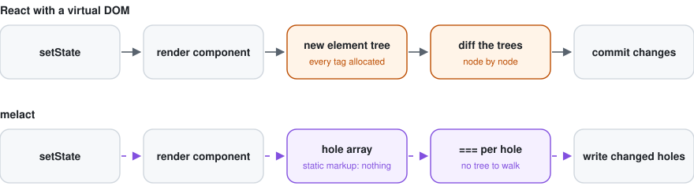

<div align="center">

<picture>
  <source media="(prefers-color-scheme: dark)" srcset="assets/logo-dark.svg">
  
</picture>

# melact

**reason-react for Melange, without React and without a virtual DOM.**

JSX compiles to DOM templates with holes. A re-render writes only the holes whose values changed.


[The idea](#the-idea) · [How it works](#how-it-works) · [Status](#status) ·
[Try it](#try-it) · [Roadmap](#roadmap) · [Not goals](#not-goals)

</div>

<br>

<picture>
  <source media="(prefers-color-scheme: dark)" srcset="assets/overview-dark.svg">
  
</picture>

> [!NOTE]
> **Milestone 1 of 7 is done:** the `View` layer, which is everything below the React API. Hooks,
> `melact-ppx` and `ReactDOM` come next. Until then, apps are written against `View` directly, like
> [`examples/counter`](examples/counter/main.ml).

## The idea

Take a reason-react + Melange app, change two lines in its `dune` files:

```diff
- (libraries reason-react)
+ (libraries melact)
- (preprocess (pps reason-react-ppx))
+ (preprocess (pps melact-ppx))
```

and get a build with no React in the bundle and no virtual DOM. Your components stay as they are:

```ocaml
(* counter.mlx *)
let[@react.component] make ~initial () =
  let count, setCount = React.useState (fun () -> initial) in
  let dec _ = setCount (fun n -> n - 1) in
  let tone = if count < 0 then "warm" else "calm" in
  <div className="counter">
    <button onClick=dec>(React.string "-")</button>
    <output className=tone>(React.int count)</output>
  </div>
```

melact keeps reason-react's surface (`React.useState`, `useEffect`, `useContext`, `ReactDOM.Client`,
`ReactEvent`, `ReactDOMStyle` …) and replaces what is underneath it.

## Why melact

<table>
<tr>
<td width="50%" valign="top">

**No virtual DOM.** A render does not build a tree of elements to diff. It builds one array: the
values of the holes in a template. Everything static is parsed once, at module load, and cloned.

</td>
<td width="50%" valign="top">

**The Elm model, made exact.** "Did this hole change" is `===`. An unchanged reference is an
unchanged value, so a physically equal child list or `lazy` argument skips its whole subtree.

</td>
</tr>
<tr>
<td valign="top">

**Updates start where state changed** *(milestone 2)*. A `setState` re-renders its own
component, not the root. Children with physically unchanged props are skipped without `memo`.

</td>
<td valign="top">

**Few DOM moves for lists.** Keyed lists keep their common prefix and suffix, and the longest
increasing run of old positions. Swapping two of 1,000 rows is 2 `insertBefore` calls.

</td>
</tr>
<tr>
<td valign="top">

**One listener per event type.** Bubbling events are delegated to `document`. A handler is a
property on its element, so a new closure each render costs one property write.

</td>
<td valign="top">

**Still reason-react.** Same JSX in mlx, Reason or OCaml `[@JSX]`, and the same hooks with the
same signatures. Pure-OCaml reason-react code is the compatibility target.

</td>
</tr>
</table>

## How it works

<picture>
  <source media="(prefers-color-scheme: dark)" srcset="assets/runtime-dark.svg">
  
</picture>

*The same update in both: the two middle steps are the difference.*

### JSX becomes a template and a hole array

<picture>
  <source media="(prefers-color-scheme: dark)" srcset="assets/pipeline-dark.svg">
  
</picture>

- **Template.** The largest static subtree of every JSX site (lowercase tags, literal attributes,
  literal text) becomes one HTML string, parsed once into a `<template>` and cloned with
  `cloneNode(true)` per mount.
- **Holes.** Each dynamic attribute, handler, text or child is a hole with a path into the clone:
  child indices for an element, a parent path and the index it goes before for inserted content.
  All paths are resolved before anything is inserted, so they never shift.
- **Hole array.** A render evaluates to `tpl_instance template [| … |]`: one array allocation for
  the whole element, whatever its size.

### A patch is one `===` per hole

<picture>
  <source media="(prefers-color-scheme: dark)" srcset="assets/patch-dark.svg">
  
</picture>

| hole | when it differs |
|---|---|
| `HText s` | `text.data = s` |
| `HAttr (Some v)` / `HAttr None` | `setAttribute` / `removeAttribute` |
| `HProp v` | `el[name] = v` (`value`, `checked`, `innerHTML`) |
| `HStyle`, `HClass` | the old properties or classes are cleared and the new ones set |
| `HHandler f` | never compared: the stored closure is replaced |
| `HRef f` | the new callback is called with the element |
| `HChild c` | patched recursively; skipped if `c` is the same reference |

Other kinds of content, with what each patch does:

- **Text against text:** the existing node's `data` is written.
- **Another template:** the old content is unmounted and the new one mounted in its place.
- **`lazy1 f a` / `lazy2 f a b`:** skipped entirely when `f` and the arguments are `==`.
- **A positional list:** the common part is patched and the tail is mounted or removed.
- **A keyed list:** reconciled as below.

### Keyed lists move as little as possible

<picture>
  <source media="(prefers-color-scheme: dark)" srcset="assets/reconcile-dark.svg">
  
</picture>

`Reconcile.plan` takes the old and new keys and returns a step per new entry: `Keep`, `Move` or
`Create`, plus the old entries to drop. It touches no DOM, so it is tested on its own. `View` then
walks the new entries right to left, inserting before the first node of the entry after. Duplicate
keys never reuse one old entry twice.

### Events are delegated

<picture>
  <source media="(prefers-color-scheme: dark)" srcset="assets/events-dark.svg">
  
</picture>

The 22 delegated types are the bubbling set Solid uses: `click`, `input`, `keydown`, `focusin`,
`pointer*`, `mouse*`, `touch*` and the rest. Any other event gets one listener on its element that
reads the same property, so replacing its handler is free too. That listener is removed on unmount.

### Components re-render where state changed

*Milestone 2, planned as follows.*

<picture>
  <source media="(prefers-color-scheme: dark)" srcset="assets/updates-dark.svg">
  
</picture>

Each `[@react.component]` will get a `Type.Id`-backed id at module level. Its props travel as a
tuple compared element-wise with `==`. Hook state lives in per-instance slots. Updates are
batched like React's, without its machinery. Layout effects run right after their instance's
patch. Passive effects run after the whole flush, and cleanups go children before parents.

### Mutate in place, and nothing updates

Change detection is physical equality, exactly as in Elm. Code that mutates an array or a
record in place and passes the same reference back will not re-render that part. Idiomatic OCaml
builds new values, so this rarely matters, but it is a rule rather than an optimisation.

## Status

| | |
|---|---|
| **Works** | `Template`, `View` (mount, patch, unmount; text, attributes, properties, styles, classes, refs, handlers, child holes; positional and keyed lists; `lazy1`/`lazy2`), `Reconcile`, delegated events, `Program.sandbox` |
| **Tests** | 26 vitest + jsdom tests. They cover every patch pair, the benchmark list operations, attribute removal, handler replacement with zero DOM calls, `lazy` skipping, and unmount removing nodes and listeners |
| **Example** | [`examples/counter`](examples/counter/main.ml), hand-written against `View` with `Program.sandbox` |
| **Not yet** | hooks, `melact-ppx`, `ReactDOM` / `ReactEvent`, SSR, benchmarks |

Writing against `View` today looks like this, and it is what `melact-ppx` will generate:

```ocaml
let counter =
  Template.make
    ~html:"<div class=\"counter\"><button>-</button><output></output><button>+</button></div>"
    ~holes:[| Handler ([ 0 ], "click"); Text ([ 1 ], 0); Handler ([ 2 ], "click") |]

let view dispatch count =
  View.tpl_instance counter
    [| HHandler (fun _ -> dispatch Decrement);
       HText (string_of_int count);
       HHandler (fun _ -> dispatch Increment) |]

let () =
  Option.iter
    (Program.sandbox ~init:0 ~update ~view)
    (element_by_id document "root")
```

## Try it

You need OCaml ≥ 5.3, Melange ≥ 5.1, dune ≥ 3.16 and Node for the tests.

```console
$ dune build                          # libraries and examples
$ dune build @runtest-js && npx vitest run
 ✓ test/view/view_test.mjs (17 tests)
 ✓ test/view/reconcile_test.mjs (9 tests)
$ npx vite                            # then open http://localhost:5173/examples/counter/
```

`vite.config.js` resolves the bare imports Melange emits (`melange.js/…`) inside each
`_build/…/output` directory, for vitest and for the examples alike.

## Roadmap

<picture>
  <source media="(prefers-color-scheme: dark)" srcset="assets/roadmap-dark.svg">
  
</picture>

| # | milestone | done when |
|---|---|---|
| 1 | **View** ✓ | patch pairs, reconcile operations, events and `lazy` pass in jsdom; the counter runs |
| 2 | **Hooks** | one test suite passes twice: against reason-react with real React, and against melact |
| 3 | **melact-ppx** | the counter in reason-react style compiles to one template with the same holes as by hand |
| 4 | **Compat** | reason-react's examples and TodoMVC build unmodified and behave identically |
| 5 | **Speed** | js-framework-benchmark within Solid's band on keyed results, memory ≤ 1.5× vanilla |
| 6 | **SSR** | `to_string` on native, hydration that binds holes to existing nodes by path |
| 7 | **Publish** | opam packages `melact` and `melact-ppx`, CI over all of the above |

The full plan is in [`SPEC.md`](SPEC.md).

## Not goals

- **npm React components.** `react-query` and other packages from npm will not work. Only
  OCaml reason-react code is the target.
- **Suspense, concurrent rendering, `useTransition` semantics.** `useTransition` and
  `startTransition` run synchronously.
- **Server components.**
- **Signals.** There is no reactive graph. A component function runs again, and its holes are
  compared.

## Layout

```
view/       melact.view     Template, View, Reconcile, Events (Melange)
program/    melact.program  Elm-style Program.sandbox over View
react/      melact          React, ReactDOM, ReactEvent, ReactDOMStyle      (milestone 2)
ppx/        melact-ppx      reason-react-ppx frontend, template emission    (milestone 3)
test/view/                  vitest + jsdom, written in OCaml
examples/                   counter, later TodoMVC and js-framework-benchmark
assets/                     the figures above: python3 assets/make.py
```
