<div align="center">

<picture>
  <source media="(prefers-color-scheme: dark)" srcset="assets/logo-dark.svg">
  
</picture>

# melact

**reason-react for Melange, without React and without a virtual DOM.**

JSX compiles to DOM templates with holes. A re-render writes only the holes whose values changed.


[The idea](#the-idea) · [How it works](#how-it-works) · [Status](#status) ·
[Try it](#try-it) · [Roadmap](#roadmap) · [Not goals](#not-goals)

</div>

<br>

<picture>
  <source media="(prefers-color-scheme: dark)" srcset="assets/overview-dark.svg">
  
</picture>

<picture>
  <source media="(prefers-color-scheme: dark)" srcset="assets/speed-dark.svg">
  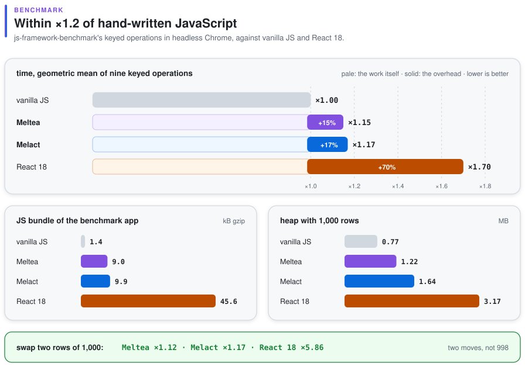
</picture>

> [!NOTE]
> **Milestones 1–3 of 7 are done:** the `View` layer, components with hooks, and `melact-ppx`.
> A reason-react component in mlx, Reason or OCaml compiles and runs, and one test suite passes
> both against reason-react with React 18 and against Melact. Milestone 4, the rest of the
> reason-react surface, is done too: the full `React.Event`, `React.createElement` with
> `makeProps`, `ReasonReactRouter`, and a community TodoMVC that runs on Melact with only its
> `dune` file changed.

## The idea

> Melact has a sibling, **Meltea**: the Elm architecture in OCaml, pure functions everywhere,
> views in mlx. Both share one Svelte-like compiler and a runtime that tends to zero. See
> [Meltea](#meltea) below and [`docs/vision.md`](docs/vision.md).

Take a reason-react + Melange app, change two lines in its `dune` files:

```diff
- (libraries reason-react)
+ (libraries melact)
- (preprocess (pps reason-react-ppx))
+ (preprocess (pps melact-ppx))
```

and get a build with no React in the bundle and no virtual DOM. Your components stay as they are:

```ocaml
(* counter.mlx *)
let[@react.component] make ~initial () =
  let count, setCount = React.useState (fun () -> initial) in
  let dec _ = setCount (fun n -> n - 1) in
  let tone = if count < 0 then "warm" else "calm" in
  <div className="counter">
    <button onClick=dec>(React.string "-")</button>
    <output className=tone>(React.int count)</output>
  </div>
```

melact keeps reason-react's surface (`React.useState`, `useEffect`, `useContext`, `ReactDOM.Client`,
`React.Event`, `ReasonReactRouter` …) and replaces what is underneath it.

<picture>
  <source media="(prefers-color-scheme: dark)" srcset="assets/surface-dark.svg">
  
</picture>

*Each line of reason-react code on the left compiles, unchanged, to what is on the right.*

## Why melact

<table>
<tr>
<td width="50%" valign="top">

**No virtual DOM.** A render does not build a tree of elements to diff. It builds one array: the
values of the holes in a template. Everything static is parsed once, at module load, and cloned.

</td>
<td width="50%" valign="top">

**The Elm model, made exact.** "Did this hole change" is `===`. An unchanged reference is an
unchanged value, so a physically equal child list or `lazy` argument skips its whole subtree.

</td>
</tr>
<tr>
<td valign="top">

**Updates start where state changed.** A `setState` re-renders its own component, not the
root. Children with physically unchanged props are skipped without `memo`.

</td>
<td valign="top">

**Few DOM moves for lists.** Keyed lists keep their common prefix and suffix, and the longest
increasing run of old positions. Swapping two of 1,000 rows is 2 `insertBefore` calls.

</td>
</tr>
<tr>
<td valign="top">

**One listener per event type.** Bubbling events are delegated to `document`. A handler is a
property on its element, so a new closure each render costs one property write.

</td>
<td valign="top">

**Still reason-react.** Same JSX in mlx, Reason or OCaml `[@JSX]`, and the same hooks with the
same signatures. Pure-OCaml reason-react code is the compatibility target.

</td>
</tr>
</table>

## How it works

<picture>
  <source media="(prefers-color-scheme: dark)" srcset="assets/vdom-dark.svg">
  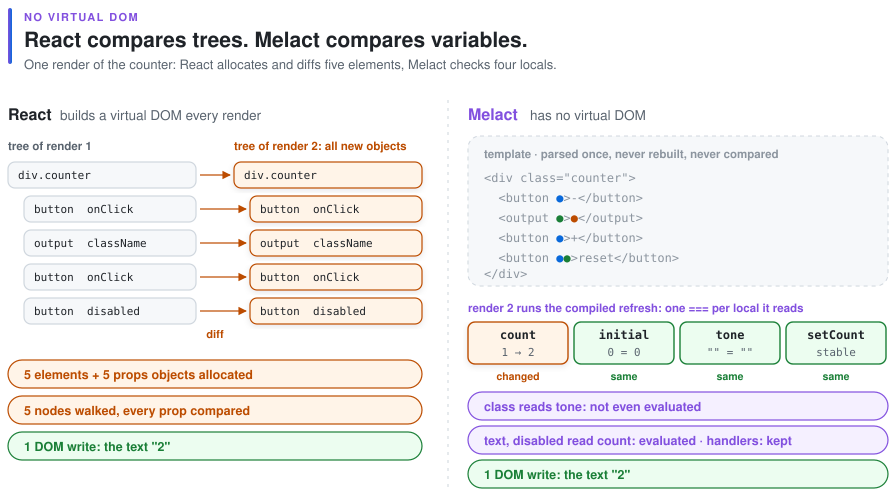
</picture>

*No virtual DOM: the DOM writes are the same, what disappears is the copy of the tree that React rebuilds and walks on every render.*

### JSX becomes a template and a hole array

<picture>
  <source media="(prefers-color-scheme: dark)" srcset="assets/pipeline-dark.svg">
  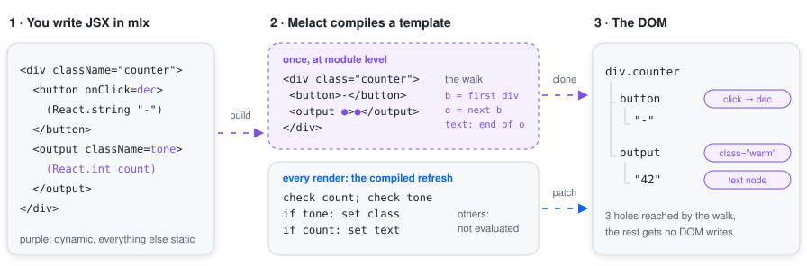
</picture>

- **Template.** The largest static subtree of every JSX site (lowercase tags, literal attributes,
  literal text) becomes one HTML string, parsed once into a `<template>` and cloned with
  `cloneNode(true)` per mount.
- **Holes.** Each dynamic attribute, handler, text or child is a hole: an element, or a parent and
  the node to insert before. The compiler emits the walk to them, `firstChild` and `nextSibling`
  only, as Svelte does; it runs on the fresh clone before anything is inserted, so nothing shifts.
- **Refresh.** For every template the compiler also emits a refresh function, as Svelte and
  dartea do. It checks each local the view reads with one `===`, and evaluates and writes only
  the holes that read a changed one. Holes that read nothing that changed are not even computed,
  so a nested tree or a `List.map` over rows behind an unchanged local costs nothing.

### A render is one `===` per local

<picture>
  <source media="(prefers-color-scheme: dark)" srcset="assets/patch-dark.svg">
  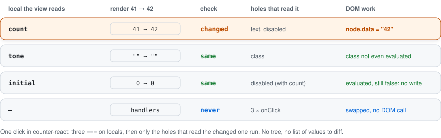
</picture>

Nothing is built to be compared afterwards. The refresh the compiler generated checks each local
the view reads, then runs only the holes that read a changed one, each writing its own node:

| hole | written with |
|---|---|
| text | `node.data = s` |
| attribute | `setAttribute` / `removeAttribute` (`None` removes) |
| property | `el[name] = v` (`value`, `checked`, `innerHTML`) |
| style | the old properties cleared, the new ones set |
| handler | guarded by the locals it reads, like any hole; Melact replaces the closure on the element, Meltea writes only the data the message needs and shares one handler per site |
| ref | the new callback is called with the element |
| child | patched recursively: a template, a list, a component |

### Keyed lists move as little as possible

<picture>
  <source media="(prefers-color-scheme: dark)" srcset="assets/reconcile-dark.svg">
  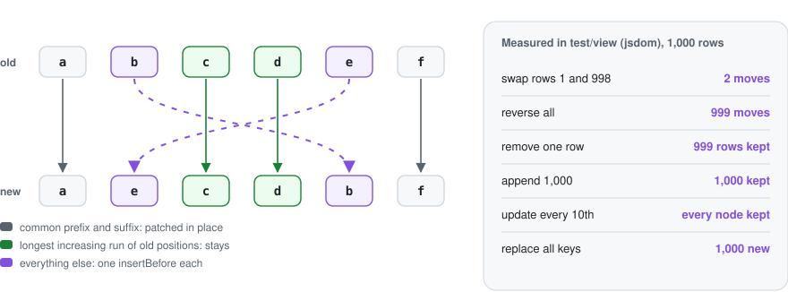
</picture>

`Reconcile.plan` takes the old and new keys and returns a step per new entry: `Keep`, `Move` or
`Create`, plus the old entries to drop. It tries the cheap cases first: common ends (a swapped
first and last row is two moves), an empty side, then a small hash table from old keys to
positions and the longest increasing run. When the keys keep their order the loop skips the plan
and patches rows in place. The plan touches no DOM, so it is tested on its own. `View` walks the
new entries right to left, inserting before the first node of the entry after. Duplicate keys
never reuse one old entry twice.

### Rows re-render only when what they read changed

<picture>
  <source media="(prefers-color-scheme: dark)" srcset="assets/selectors-dark.svg">
  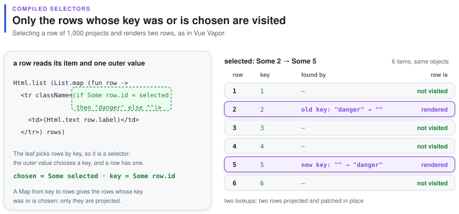
</picture>

`React.array (Array.map row items)` and Meltea's `Html.list (List.map row items)` compile to a
keyed loop. As in Vue Vapor's selectors, the compiler splits a row into its item and its leaves,
the smallest pieces without JSX that read outer variables, and emits a projection that evaluates
only those. A row whose item is the same object and whose projection did not change is kept
without calling the row function: selecting one row of 1,000 renders two.

<picture>
  <source media="(prefers-color-scheme: dark)" srcset="assets/row-dark.svg">
  
</picture>

A row that is one element with a `key` compiles further, to `View.rows`: one record per row, holes
that are the bare nodes, the last written values kept next to the guarded locals, and in Meltea
one handler per site that reads the row's data from the element it was clicked on.

### Events are delegated

<picture>
  <source media="(prefers-color-scheme: dark)" srcset="assets/events-dark.svg">
  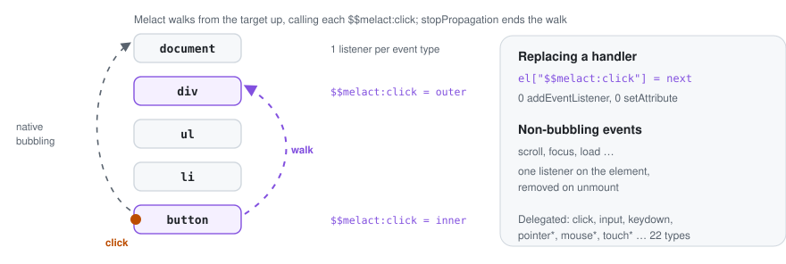
</picture>

The 22 delegated types are the bubbling set Solid uses: `click`, `input`, `keydown`, `focusin`,
`pointer*`, `mouse*`, `touch*` and the rest. Any other event gets one listener on its element that
reads the same property, so replacing its handler is free too. That listener is removed on unmount.

### Inputs show the state

<picture>
  <source media="(prefers-color-scheme: dark)" srcset="assets/controlled-dark.svg">
  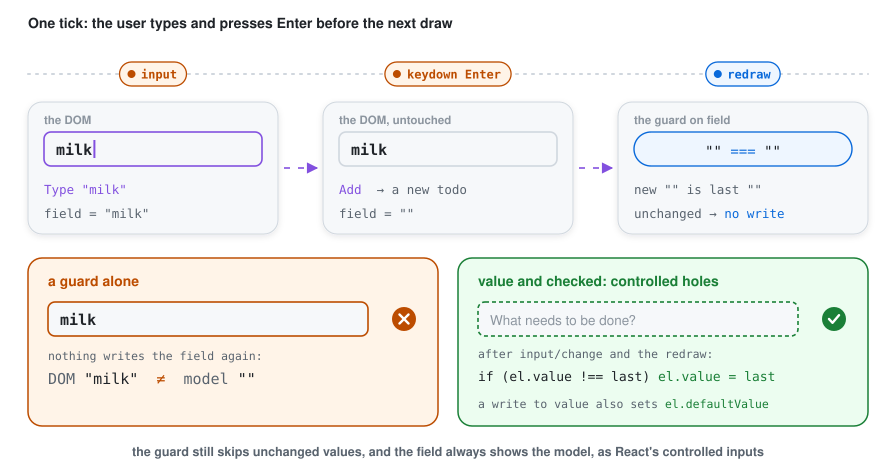
</picture>

A guard compares a value with the one written last, but the user changes `value` and `checked`
too. So these two props are controlled holes: after an `input` or `change` event, and the redraw
it causes, the hole writes its last value back if the DOM differs. A handler that filters or
rejects input keeps the field in step with the state, as in React; one law types into such a
field and checkbox under React 18 and under Melact and compares the page.

### Server rendering and hydration

<picture>
  <source media="(prefers-color-scheme: dark)" srcset="assets/hydration-dark.svg">
  
</picture>

`ReactDOMServer.renderToString` (Meltea: `Program.render`) writes HTML in the format of React's own
`renderToString`, with no markers, so a Melact app can also render on a native OCaml server with
[server-reason-react](https://github.com/ml-in-barcelona/server-reason-react).
`ReactDOM.Client.hydrateRoot` (`~start:Program.hydrate`) takes that HTML over in document order
with code the compiler generates for each template under its `-hydratable` flag: it keeps the
server's elements and sets handlers. HTML that does not match the view is replaced by a normal
mount. `Melhole_server.capture`, a script for the page's head, records what the user does before
the code arrives, with each field's value at that moment, and hydration delivers it in order.

<picture>
  <source media="(prefers-color-scheme: dark)" srcset="assets/served-dark.svg">
  
</picture>

A server does not need a DOM either. Under `meltea-ppx -server` the same view compiles to code
that writes its HTML through `melhole.server`, plain OCaml that runs natively and in Node:
static markup joined into a few strings at compile time and one call per dynamic part.
`meltea.server` has Meltea's `Html`, `Cmd`, `Sub` and `Program`, so one module with the model,
`update` and `view` builds for both sides; [`examples/served`](examples/served) is a native
server and the client that hydrates its page.

### Components re-render where state changed

<picture>
  <source media="(prefers-color-scheme: dark)" srcset="assets/updates-dark.svg">
  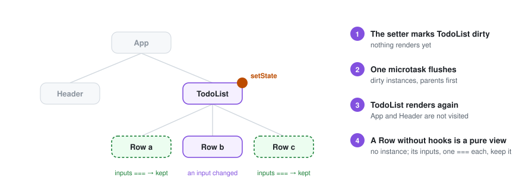
</picture>

Each `[@react.component]` gets an identity at module level. Its props are compared one by one
with `===`. A component that calls no hook compiles to a pure view with no instance, kept while
its props are the same. A setter marks its instance dirty, and one microtask
renders the dirty instances parents first. Layout effects run right after their instance's
patch. Passive effects run after the whole flush, and cleanups go children before parents. A
component that renders nothing keeps its place with an empty text node.

### Hooks are typed by their call site

<picture>
  <source media="(prefers-color-scheme: dark)" srcset="assets/hooks-dark.svg">
  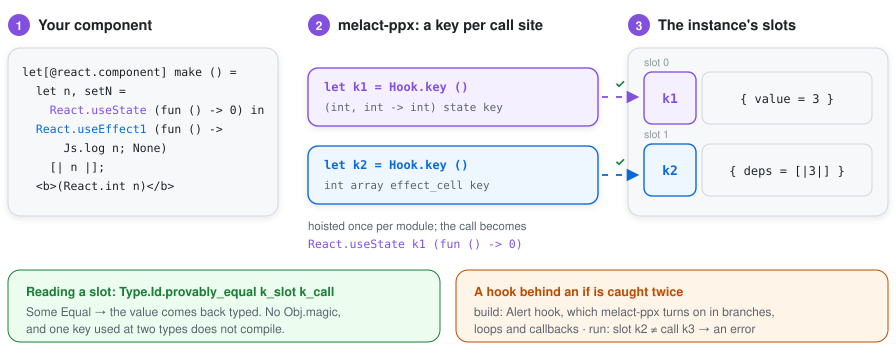
</picture>

Hooks keep state in slots read in call order, as in React. Instead of casting what a slot holds,
`melact-ppx` gives every `React.useState`, `useEffect`, `useMemo`… call site its own key,
a `Type.Id` created once at module level, and passes it as a hidden first argument:

```ocaml
(* you write *)
let count, setCount = React.useState (fun () -> 0)

(* melact-ppx emits *)
let __melhole_hook_2 = Melact_runtime.Hook.key ()
let count, setCount = (React.useState __melhole_hook_2) (fun () -> 0)
```

A slot stores its value with the key that made it, so reading it back is a typed
`Type.Id.provably_equal`, with no `Obj.magic`. A hook inside an `if`, a `match`, a loop or a
callback raises the `hook` alert at build time; at run time a hook called out of order raises
*"hooks were called in a different order"* instead of handing back the wrong value. Using one
key at two types is a compile error. Hooks inside custom hooks get keys the same way.

### Mutate in place, and nothing updates

Change detection is physical equality, exactly as in Elm. Code that mutates an array or a
record in place and passes the same reference back will not re-render that part. Idiomatic OCaml
builds new values, so this rarely matters, but it is a rule rather than an optimisation.

## Meltea

<p align="center">
  <picture>
    <source media="(prefers-color-scheme: dark)" srcset="assets/meltea-dark.svg">
    
  </picture>
</p>

<picture>
  <source media="(prefers-color-scheme: dark)" srcset="assets/family-dark.svg">
  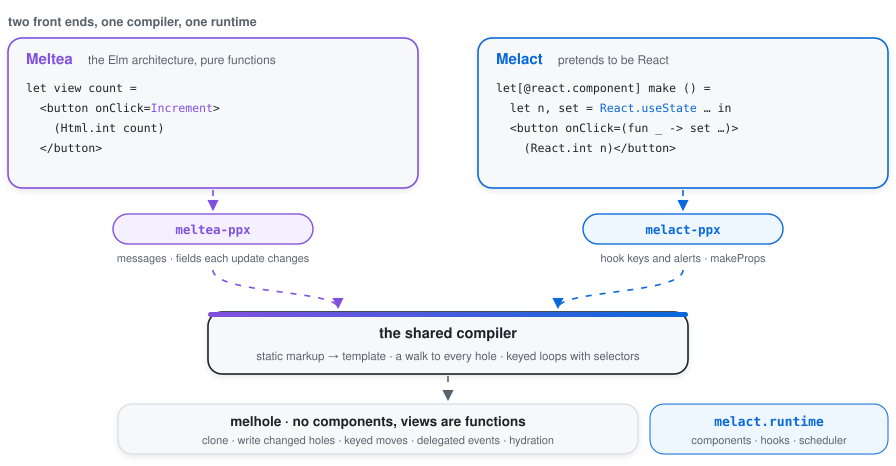
</picture>

Meltea is the Elm architecture in OCaml: a model, messages, a pure `update` and a pure `view`
in mlx. No hooks and no components with state: an event handler is a message.

```ocaml
type message = Increment | Decrement | Reset

let update message count =
  match message with Increment -> count + 1 | Decrement -> count - 1 | Reset -> 0

let view count =
  <div className="counter">
    <button onClick=Decrement>(Html.text "-")</button>
    <output>(Html.int count)</output>
    <button onClick=Increment>(Html.text "+")</button>
    <button onClick=Reset disabled=(count = 0)>(Html.text "reset")</button>
  </div>

let () = Option.iter (fun root -> ignore (Program.sandbox ~init:0 ~update ~view root)) root
```

<picture>
  <source media="(prefers-color-scheme: dark)" srcset="assets/compiled-dark.svg">
  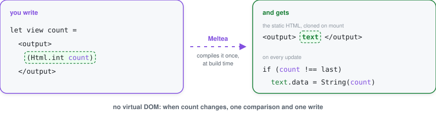
</picture>

`meltea-ppx` compiles the view with the same template compiler as `melact-ppx`. `onClick=Increment`
sends a message, `onInput` and `onKeyDown` take a function of the value or key, `onCheck` of the
checked state. `Program.sandbox` and `Program.element` run it, with `Cmd` and `Sub` as plain
values; `Html.map` and `Html.memo` work as in Elm. Dependencies: `(libraries meltea)` and
`(pps melange.ppx meltea-ppx)`. Examples: [`examples/counter`](examples/counter/main.mlx) and
[`examples/todomvc`](examples/todomvc/todomvc.mlx), the full TodoMVC with routing, editing and
`localStorage`.

<picture>
  <source media="(prefers-color-scheme: dark)" srcset="assets/fields-dark.svg">
  
</picture>

`meltea-ppx` also reads `update` and `view` for the model fields each message can change and the
view reads. A message that changes nothing the view reads does not call the view at all.

<picture>
  <source media="(prefers-color-scheme: dark)" srcset="assets/fanout-dark.svg">
  
</picture>

The same reading follows every frequent event (typing, keys, pointer moves, scroll) through the
message it sends and the fields that message writes to the lists that read them. Where typing
would make a list check all its rows on every keystroke, the compiler says so at the handler with
an alert, `fanout`, and the user writes nothing to get it.

<picture>
  <source media="(prefers-color-scheme: dark)" srcset="assets/remember-dark.svg">
  
</picture>

A derived `let` at the top of a view is remembered by the fields it reads, so typing in a field no
longer rebuilds a filtered list and makes its loop check every row.

<picture>
  <source media="(prefers-color-scheme: dark)" srcset="assets/hot-dark.svg">
  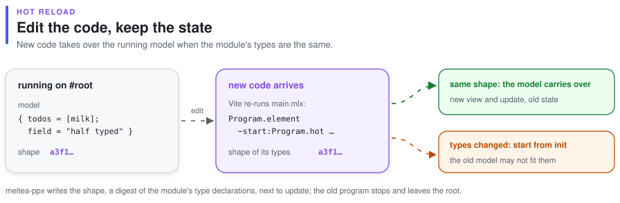
</picture>

`~start:Program.hot` with Vite's HMR shows an edit as the new view of the old model, as elm-watch
does, and starts from `init` when the module's types changed.

### Transitions

<picture>
  <source media="(prefers-color-scheme: dark)" srcset="assets/transition-dark.svg">
  
</picture>

`Html.transition ~name` and `Html.transition_group ~name` animate what enters and leaves, as Vue's
`<Transition>` and `<TransitionGroup>`: CSS classes named after `name`, the leaving element kept
in place until its transition ends, and in a group the rows that move slid from where they were
(FLIP). A list inside a group is still the compiled keyed loop with selectors. The code lives in
melhole's `Transition` module, so an app that does not animate does not carry it.

```ocaml
let view model =
  <ul className="todo-list">
    (Html.transition_group ~name:"fade" (Html.list (List.map row (visible model))))
  </ul>
```

```css
.fade-enter-from, .fade-leave-to { opacity: 0; }
.fade-enter-active, .fade-leave-active, .fade-move { transition: all 200ms; }
```

## Status

[`compat/run.sh`](compat/run.sh) clones reason-react, melange-opam-template and reason-seoul's TodoMVC, changes two lines
in their `dune` files and builds them against Melact. Then it renders reason-react's demo with React and with Melact and
compares the DOM after every click (37 steps, all identical), and walks the TodoMVC randomly (five walks, 605 steps of clicks, typing, submits and
route changes) comparing the DOM after every step. The TodoMVC was written for reason-react 0.9, so both copies first get
the same upgrade to reason-react 0.17 (`ReactEvent.` becomes `React.Event.`, and `Index.re` uses `ReactDOM.Client`). One
demo component binds React's own `useReducer` from npm (`external … [@@mel.module "react"]`); melact-ppx
rewrites such bindings to Melact's hooks (`useState`, `useReducer`, `useEffect` with or without deps, `useMemo`,
`useCallback`, `useRef`, `useContext`, `createPortal`, …), so it runs as it is.

| | |
|---|---|
| **Works** | `View`, `Template`, `Reconcile`, delegated events; components, context and every reason-react hook with a key (`useState`, `useReducer`, `useEffect*`, `useLayoutEffect*`, `useMemo*`, `useCallback*`, `useRef`, `useImperativeHandle*`, `useId`, `useInsertionEffect0`–`7`, `useSyncExternalStore` and `…WithServer`, `useDeferredValue`, `useTransition` and `useTransitionAsync`); `React.memo`, `React.act`, `ReactDOM.Client`, `ReactDOM.Style`, `ReactDOM.Ref`, every `React.Event` family over native events (handlers see the `currentTarget` they were set on, as in React), `React.createElement`, `React.jsx`, `jsxKeyed` and friends with `makeProps`, code typed against `React.component('props)` (wrappers, `React.memo`, `React.component`, hand-written modules with a `[@mel.obj] makeProps` and `props##field`), `ReasonReactRouter`, `ReactDOMTestUtils` (`Simulate` sends the native event Melact listens to), `ReasonReactErrorBoundary` (render, update and effect errors handled pass by pass as React 18 does); DOM elements built at run time with `ReactDOM.domProps`, `ReactDOM.createElement`, `createDOMElementVariadic`, `jsx`, `stringToComponent` and `React.createElementVariadic`; bindings written to npm's `react` (`[@@mel.module "react"]`) rewritten to Melact's hooks, dependencies as arrays or tuples, also when the bindings live in another file, and bindings to npm's `createElement`, `jsx`, `jsxs` and `Fragment` that return a `React.element` build Melact elements; `melact-ppx` for Reason, OCaml `[@JSX]` and mlx |
| **Size** | whole apps, runtime and the Melange stdlib they use included: the counter is 3.0 kB gzip with Meltea and 5.6 kB with Melact, TodoMVC in Meltea is 14.7 kB, most of it jsonkit's `Printf` for error messages; React 18.3 and react-dom alone are 45 kB |
| **Speed** | [`bench/`](bench/README.md) reproduces js-framework-benchmark's keyed operations in headless Chrome: geometric mean of the slowdown against hand-written vanilla JS is 1.15 for Meltea, 1.17 for Melact and 1.70 for React 18 (the ratios move by about 0.1 between runs); a list re-renders only the rows whose item changed, and swapping two rows of 1,000 moves two rows (React moves 998) |
| **Tests** | 160 vitest + jsdom tests and 25 native QCheck laws: the View layer, transitions under fake timers, the keyed loop and its projections, pure components, hooks against `View` directly, and one suite in mlx built twice, against reason-react with React 18 and against melact, with identical assertions. `melact-ppx` has expect tests for every JSX shape in [`test/ppx/jsx.t`](test/ppx/jsx.t) |
| **Examples** | [`examples/counter-react`](examples/counter-react/counter.mlx), Melact in reason-react style; [`examples/counter`](examples/counter/main.mlx) and [`examples/todomvc`](examples/todomvc/todomvc.mlx), Meltea |
| **Server** | `ReactDOMServer.renderToString` and `ReactDOM.Client.hydrateRoot`; Meltea has `Program.render` and `~start:Program.hydrate`. The HTML is in React's format, so React's own and server-reason-react's hydrate too; hydration code is compiled under `-hydratable`. `meltea-ppx -server` compiles a view to code that writes its HTML with no DOM, natively or in Node ([`examples/served`](examples/served)); a Melact app renders natively with server-reason-react. `Melhole_server.capture`, a script for the page's head, keeps clicks and typing made before the code arrives and hydration delivers them |
| **Not yet** | `React.Experimental` (React 19's `use`, `useOptimistic`, `useActionState`), `ReactDOMTestUtils.isElementOfType`, reading a `domProps` back field by field, Suspense on the server |
| **Limits** | a `make` written by hand with labels and no `[@react.component]` is not a component in JSX (it is not in reason-react either): mark it `[@react.component]`; a hand-written `make` that calls hooks runs them in its parent, so call it unconditionally; a component or custom hook that is polymorphic in its state type gets a weak type for its hook key; annotate it, or keep the state type concrete |

A whole tree compiles to one template. This mlx counter is one `<template>` with six holes,
the same as the hand-written one:

```ocaml
let[@react.component] make ~initial () =
  let count, setCount = React.useState (fun () -> initial) in
  let tone = if count < 0 then "negative" else "" in
  <div className="counter">
    <button onClick=(fun _ -> setCount (fun n -> n - 1))>(React.string "-")</button>
    <output className=tone>(React.int count)</output>
    <button onClick=(fun _ -> setCount (fun n -> n + 1))>(React.string "+")</button>
    <button onClick=(fun _ -> setCount (fun _ -> initial)) disabled=(count = initial)>
      (React.string "reset")
    </button>
  </div>
```

## Try it

You need OCaml ≥ 5.4, Melange ≥ 5.1, dune ≥ 3.16 and Node for the tests.

```console
$ dune build                          # libraries and examples
$ dune build @runtest-js && npx vitest run
 ✓ test/view/view_test.mjs (17 tests)
 ✓ test/view/reconcile_test.mjs (9 tests)
 ✓ test/react/hooks_test.mjs (15 tests)
 ✓ test/dual/react/dual_test.mjs (11 tests)
 ✓ test/dual/melact/dual_test.mjs (11 tests)
$ dune test test/ppx                  # melact-ppx expect tests
$ npx vite                            # then open http://localhost:5173/examples/counter/
```

`vite.config.js` resolves the bare imports Melange emits (`melange.js/…`) inside each
`_build/…/output` directory, for vitest and for the examples alike.

## Roadmap

<picture>
  <source media="(prefers-color-scheme: dark)" srcset="assets/roadmap-dark.svg">
  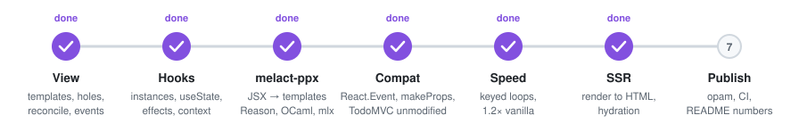
</picture>

| # | milestone | done when |
|---|---|---|
| 1 | **View** ✓ | patch pairs, reconcile operations, events and `lazy` pass in jsdom; the counter runs |
| 2 | **Hooks** ✓ | one test suite passes twice: against reason-react with real React, and against melact |
| 3 | **melact-ppx** ✓ | the counter in reason-react style compiles to one template with the same holes as by hand |
| 4 | **Compat** | reason-react's examples and TodoMVC build unmodified and behave identically |
| 5 | **Speed** ✓ | keyed loops, selectors and pure components: about 1.2× vanilla JS on the keyed benchmark, React 18 about 1.7× |
| 6 | **SSR** ✓ | `ReactDOMServer.renderToString` / `Program.render`, and hydration that takes the server's nodes over |
| 7 | **Publish** (now) | CI runs every law on each push ✓; next, the opam packages `melhole`, `melact`, `melact-ppx`, `meltea`, `meltea-ppx` |

The full plan is in [`SPEC.md`](SPEC.md).

## Not goals

- **npm React components.** `react-query` and other packages from npm will not work. Only
  OCaml reason-react code is the target.
- **Suspense, concurrent rendering, `useTransition` semantics.** `useTransition` and
  `startTransition` run synchronously.
- **Server components.**
- **Signals.** There is no reactive graph. A component function runs again, and its holes are
  compared.

## Layout

```
melhole/runtime     melhole           shared runtime: templates, guards, keyed moves, events
melhole/server      melhole.server    HTML without a DOM, natively or under Melange
react/runtime       melact.runtime    React's components: instances, hook slots, context, scheduler
melhole/compiler    melhole.compiler  shared compiler: templates, scopes, guards, DOM props
ppx/melact         melact-ppx       JSX, [@react.component], hook keys
ppx/meltea         meltea-ppx       mlx views with messages
react/             melact           React (with React.Event), ReactDOM, ReasonReactRouter
meltea/            meltea           the Elm architecture: Program, Cmd, Sub, Html
meltea/server      meltea.server    the same modules on a server: views write HTML
test/                               laws: QCheck, fast-check in jsdom, React vs Melact
examples/                           counter (Meltea), counter-react (Melact)
compat/                             real reason-react apps built against Melact
assets/                             the figures above: python3 assets/make.py
```
